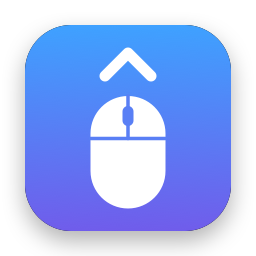
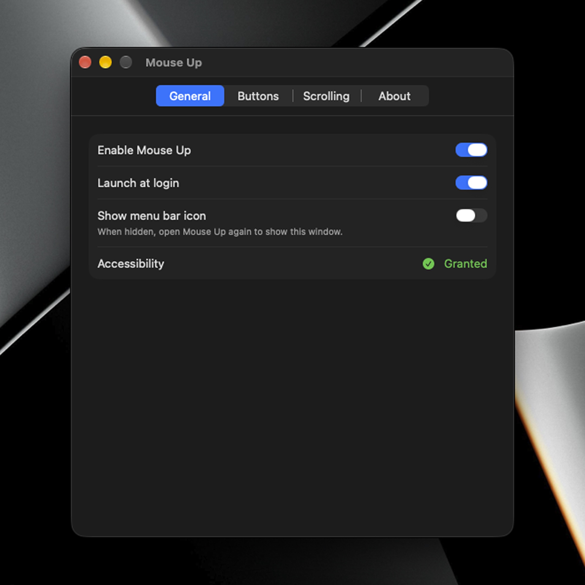
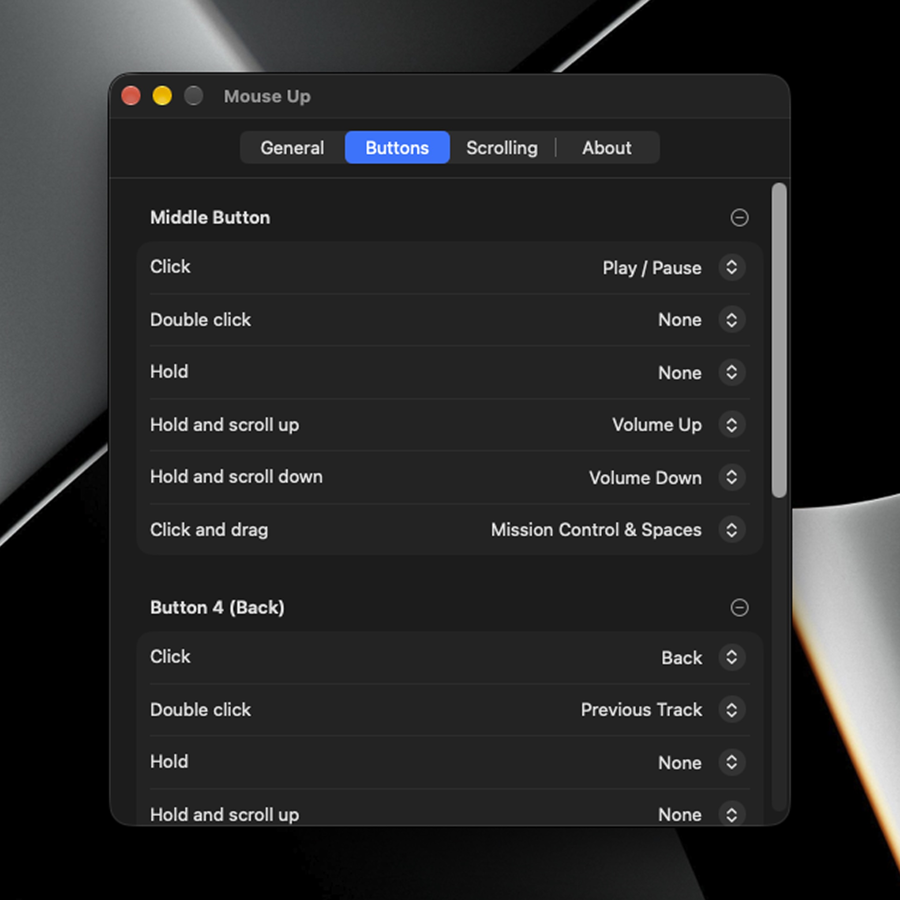
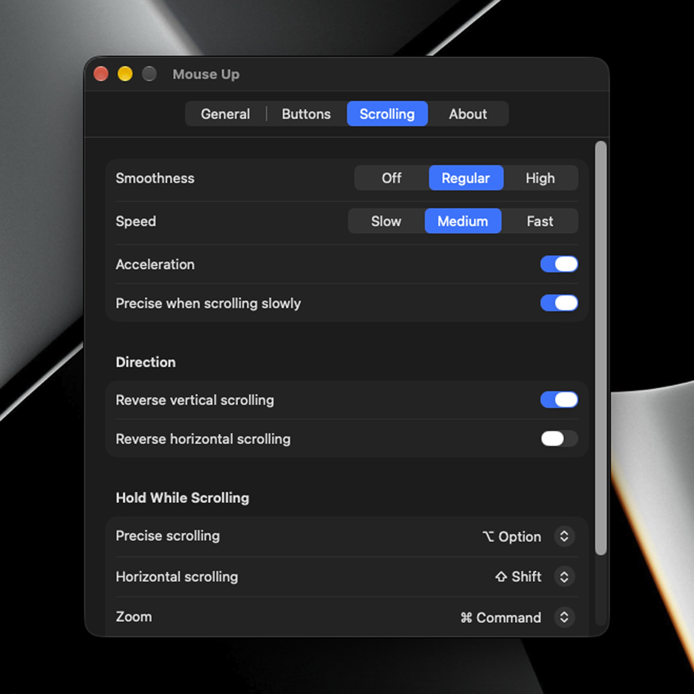
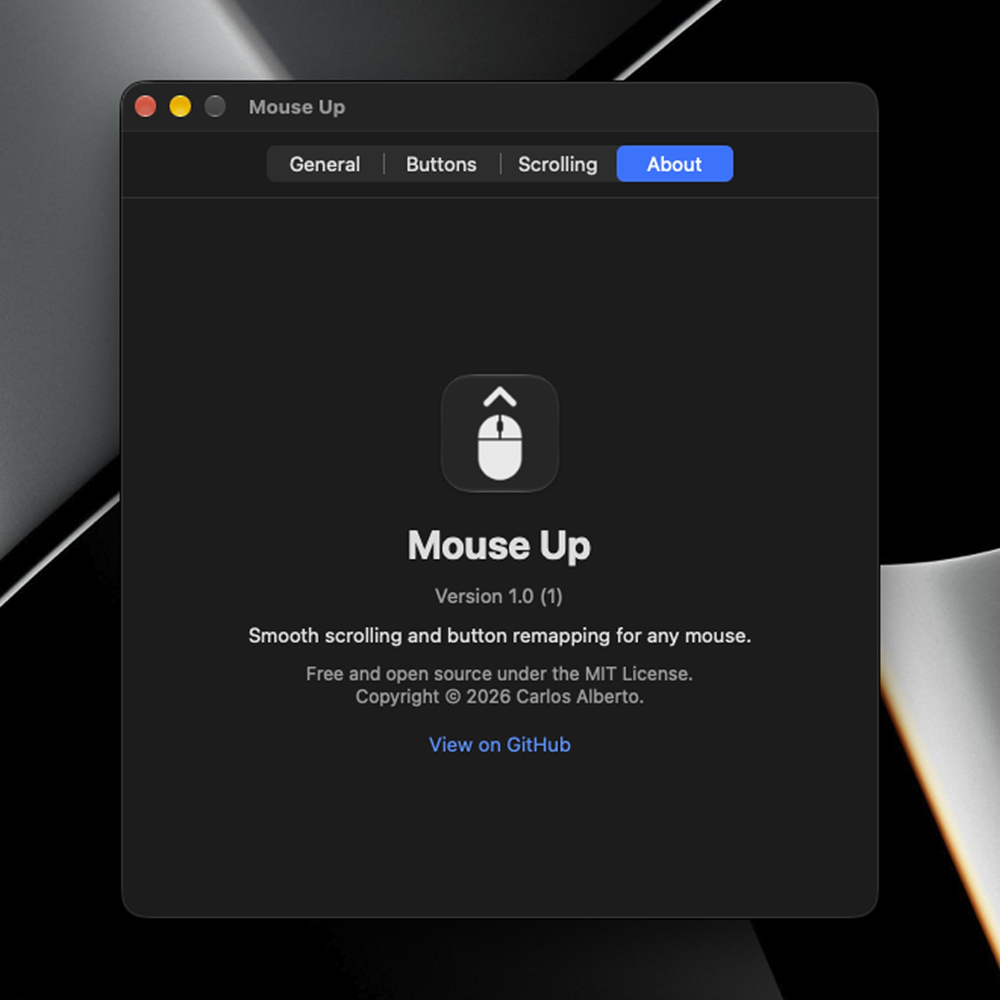

<div align="center">



# Mouse Up

**Smooth scrolling and button shortcuts for any mouse on macOS.**


[](LICENSE)

[Features](#features) • [Install](#install) • [Usage](#usage) • [How it works](#how-it-works) • [Limitations](#limitations)

English • <a href="README.pt-BR.md">Português</a>

</div>

Mouse Up is a free menu bar app that makes a regular mouse feel closer to a trackpad. It adds smooth scrolling with momentum and lets you turn the side buttons into shortcuts: control your music, Mission Control, Spaces, keyboard shortcuts and more.

It reads mouse events through a macOS event tap, changes the ones you configured and lets everything else through. Trackpads and the Magic Mouse are never touched.

<p align="center">
  
  
</p>
<p align="center">
  
  
</p>

> [!NOTE]
> Mouse Up is an independent project inspired by Mac Mouse Fix. It contains no code from it and is not affiliated with it.

## Features

- **Music controls on your mouse:** play/pause, volume up and down, next and previous track. Hold a side button and scroll to change the volume, or double click to skip a song. Works with Music, Spotify and music playing in the browser.
- **Smooth scrolling:** each wheel step becomes a short animation with momentum, like a trackpad. Smoothness **Off**, **Regular** or **High**.
- **Speed and acceleration:** **Slow**, **Medium** or **Fast**, and fast consecutive steps scroll further.
- **Simulate trackpad:** scrolling reaches apps as trackpad scrolling, with rubber banding and swipe gestures. Turn it off to keep smooth scrolling without trackpad behavior.
- **Precise scrolling:** turning the wheel slowly gives small, exact steps. You can turn this off.
- **Reverse direction:** vertical and horizontal separately, independent of the system setting.
- **Hold a key while scrolling:** <kbd>⌥</kbd> precise, <kbd>⇧</kbd> horizontal, <kbd>⌘</kbd> zoom, <kbd>⌃</kbd> fast. Each key can be changed or turned off.
- **Button shortcuts:** for back, forward and extra buttons, a separate action for click, double click, triple click, hold, hold and scroll up, hold and scroll down.
- **Click and drag:** hold a button and drag for Mission Control and Spaces, to scroll content, or for your own action in each direction (up, down, left, right).
- **Actions:** Back, Forward, Middle Click, Mission Control, App Exposé, Show Desktop, Launchpad, Space left or right, Look Up, Smart Zoom, Volume Up and Down, Play / Pause, Next and Previous Track, or any keyboard shortcut.
- **The wheel button stays native:** middle click and middle drag keep working in apps like Figma and browsers.
- **Menu bar app:** optional menu bar icon, launch at login, and a Dock icon only while the window is open.

## Install

### Download the prebuilt app

1. Download `Mouse-Up.zip` from the [latest release](https://github.com/CarlosAllberto/mouse-up/releases/latest).
2. Unzip it and move `Mouse Up.app` to `/Applications`.
3. Open the app and allow Accessibility access when it asks.

> [!NOTE]
> The app is not notarized by Apple yet, so macOS blocks it the first time you open it. Go to **System Settings > Privacy & Security** and click **Open Anyway**.

### Build from source

Requirements:

- macOS 13 or later
- Xcode 15 or later
- [XcodeGen](https://github.com/yonaskolb/XcodeGen)

```bash
brew install xcodegen
```

The Xcode project is generated from [`project.yml`](project.yml) and is not committed.

```bash
git clone https://github.com/CarlosAllberto/mouse-up.git
cd mouse-up
xcodegen generate
xcodebuild -project MouseUp.xcodeproj -scheme MouseUp -configuration Release -derivedDataPath build build
```

The app is created at `build/Build/Products/Release/Mouse Up.app`. Copy it to `/Applications` and open it.

> [!IMPORTANT]
> Mouse Up needs Accessibility access to read your mouse. On first launch it shows a window with an **Open System Settings** button. Turn on Mouse Up in **System Settings > Privacy & Security > Accessibility** and it starts working within a second. Nothing is recorded or sent anywhere.

> [!NOTE]
> The app is ad-hoc signed (`CODE_SIGN_IDENTITY: "-"`) to run on your own Mac. Every new build has a new signature, so remove Mouse Up from the Accessibility list with **−** and add it again after rebuilding. To distribute it, sign it with a Developer ID and notarize it.

## Usage

| Action | How |
| --- | --- |
| Open the window | Click the menu bar icon, **Open App**, or open Mouse Up again |
| Turn everything on or off | Menu bar icon, **Enabled**, or **General > Enable Mouse Up** |
| Add a button | **Buttons > Add Button…**, then press the mouse button |
| Set a shortcut | Pick an action next to **Click**, **Double click**, **Triple click**, **Hold** or **Hold and scroll** |
| Record a keyboard shortcut | Choose **Keyboard Shortcut** in any action list, then press the keys. <kbd>Esc</kbd> cancels |
| Drag in four directions | **Click and drag > Custom Directions**, then pick **Drag up**, **Drag down**, **Drag left** and **Drag right** |
| Scroll precisely | Turn the wheel slowly, or hold <kbd>⌥</kbd> |
| Scroll sideways | Hold <kbd>⇧</kbd> while scrolling |
| Zoom | Hold <kbd>⌘</kbd> while scrolling |
| Hide the menu bar icon | **General > Show menu bar icon**. Open Mouse Up again to show the window |

Default buttons: button 4 is **Back** and button 5 is **Forward**.

## How it works

```
Sources/
├── App.swift            App entry, menu bar item, main window
├── Permissions.swift    Accessibility onboarding
├── EventTap.swift       One event tap that routes mouse events
├── ScrollEngine.swift   Smooth scrolling, speed, modifiers, reverse
├── ButtonEngine.swift   Click, multi-click, hold, drag and scroll triggers
├── Actions.swift        System actions, media keys, keyboard shortcuts
├── Settings.swift       Settings model saved in UserDefaults
└── SettingsView.swift   SwiftUI window with the four tabs
```

- **One event tap.** [`EventTap.swift`](Sources/EventTap.swift) listens to scroll and extra button events. Events Mouse Up posts itself are tagged, so they are never processed twice.
- **Trackpad-like scrolling.** [`ScrollEngine.swift`](Sources/ScrollEngine.swift) swallows each wheel step and posts pixel scroll events with scroll and momentum phases, so apps handle them like trackpad scrolling.
- **Button triggers.** [`ButtonEngine.swift`](Sources/ButtonEngine.swift) runs a small state machine per button. A button with only a click action fires on press, with no delay. Double and triple click wait the system double-click interval.
- **Actions.** [`Actions.swift`](Sources/Actions.swift) opens system apps where they exist (Mission Control, Launchpad), posts media key events for volume and playback, and posts key combinations for the rest.

## Limitations

- **Back** and **Forward** send <kbd>⌘</kbd> <kbd>[</kbd> and <kbd>⌘</kbd> <kbd>]</kbd>, so they work in browsers, Finder and Xcode, but not in every app.
- App Exposé, Show Desktop and Spaces use the shortcuts in **System Settings > Keyboard > Keyboard Shortcuts > Mission Control**. If you changed or turned them off, these actions stop working.
- Zoom and **Smart Zoom** send <kbd>⌘</kbd> <kbd>=</kbd> and <kbd>⌘</kbd> <kbd>-</kbd>. macOS has no public way to create a pinch gesture.
- A button with a double or triple click action waits a moment before running its single click.
- Some mice block or change wheel events while a side button is held. Hold and scroll then can't work on that button.
- The wheel button (middle button) can't be configured, on purpose, so apps keep their native middle click and drag.
- Not available on the Mac App Store: the App Store sandbox does not allow a global event tap.
- The interface is in English only.

## Development

- **Self-tests:** Debug builds run small checks on the scroll math and the drag direction logic at launch.
- **Log:** permission checks are written to `~/Library/Logs/MouseUp.log`.
- **Icon:** the app icon is drawn by [`scripts/make-icon.swift`](scripts/make-icon.swift).
