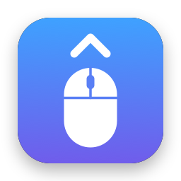
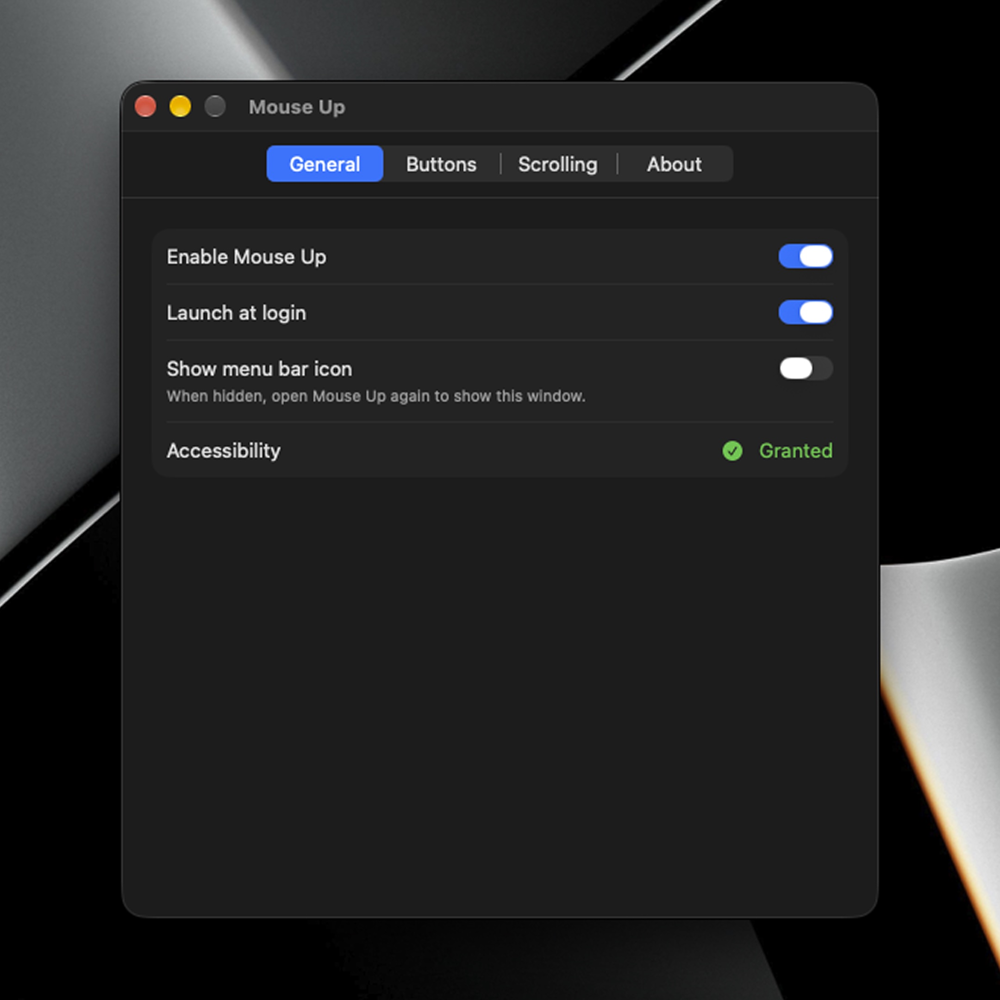
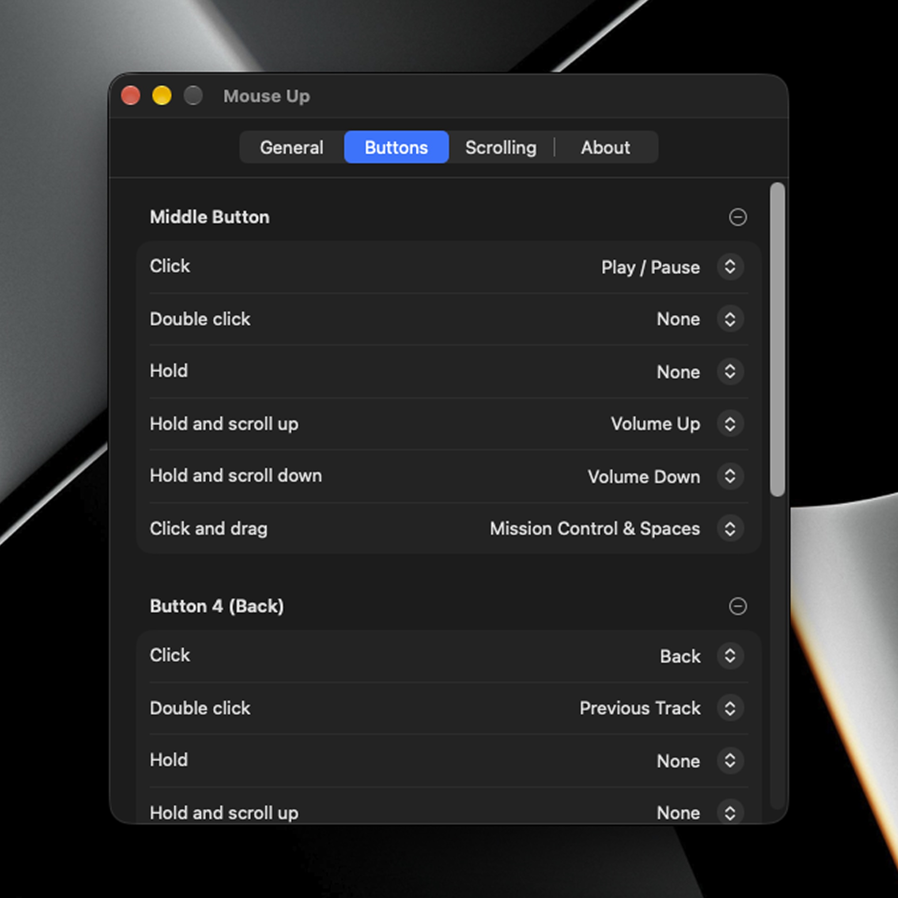
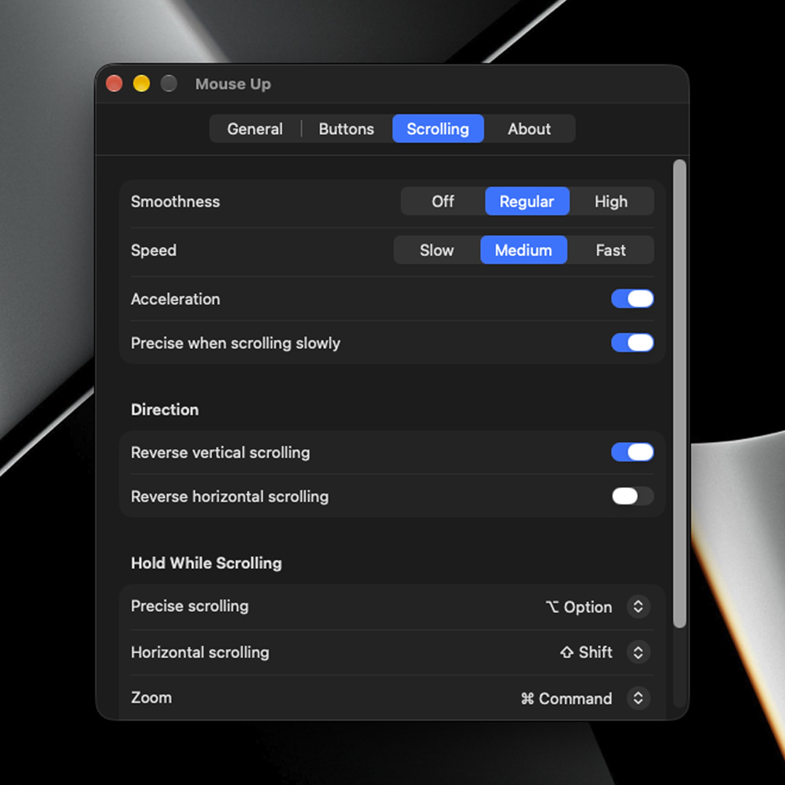
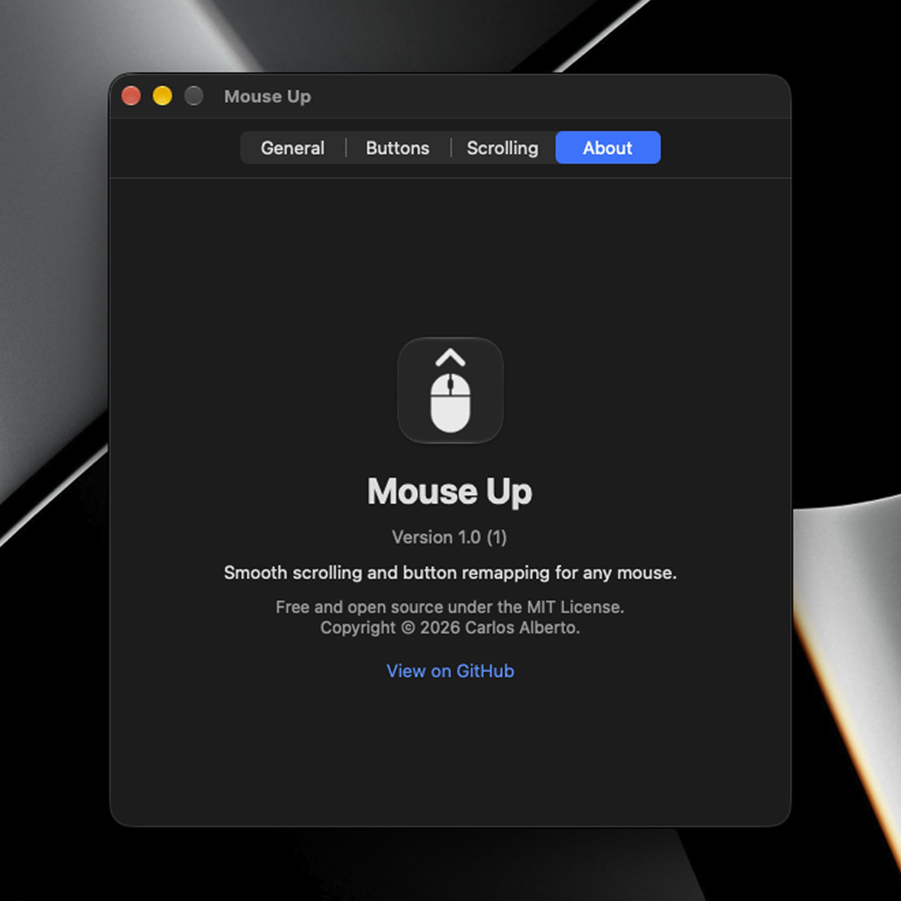

<div align="center">



# Mouse Up

**Rolagem suave e atalhos nos botões para qualquer mouse no macOS.**


[](LICENSE)

[Recursos](#recursos) • [Instalação](#instalação) • [Uso](#uso) • [Como funciona](#como-funciona) • [Limitações](#limitações)

<a href="README.md">English</a> • Português

</div>

O Mouse Up é um app gratuito de menu bar que deixa um mouse comum mais perto de um trackpad. Ele adiciona rolagem suave com inércia e transforma os botões laterais em atalhos: controle da música, Mission Control, Spaces, atalhos de teclado e mais.

Ele lê os eventos do mouse por um event tap do macOS, altera os que você configurou e deixa o resto passar. Trackpads e o Magic Mouse nunca são alterados.

<p align="center">
  
  
</p>
<p align="center">
  
  
</p>

> [!NOTE]
> O Mouse Up é um projeto independente, inspirado no Mac Mouse Fix. Não contém código dele e não tem vínculo com ele.

## Recursos

- **Controle de música no mouse:** play/pause, aumentar e abaixar o volume, passar e voltar música. Segure um botão lateral e role para mudar o volume, ou dê duplo clique para pular a música. Funciona com o Música, o Spotify e música tocando no navegador.
- **Rolagem suave:** cada passo da rodinha vira uma animação curta com inércia, como no trackpad. Suavidade **Off**, **Regular** ou **High**.
- **Velocidade e aceleração:** **Slow**, **Medium** ou **Fast**, e passos rápidos seguidos rolam mais longe.
- **Rolagem precisa:** girar a rodinha devagar dá passos pequenos e exatos. Dá para desligar.
- **Inverter direção:** vertical e horizontal separados, independente do ajuste do sistema.
- **Segurar uma tecla ao rolar:** <kbd>⌥</kbd> precisa, <kbd>⇧</kbd> horizontal, <kbd>⌘</kbd> zoom, <kbd>⌃</kbd> rápida. Cada tecla pode ser trocada ou desligada.
- **Atalhos nos botões:** para voltar, avançar e botões extras, uma ação separada para clique, duplo clique, clique triplo, segurar, segurar e rolar para cima, segurar e rolar para baixo.
- **Clicar e arrastar:** segure um botão e arraste para Mission Control e Spaces, para rolar o conteúdo, ou para uma ação sua em cada direção (cima, baixo, esquerda, direita).
- **Ações:** Back, Forward, Middle Click, Mission Control, App Exposé, Show Desktop, Launchpad, Space à esquerda ou à direita, Look Up, Smart Zoom, Volume Up e Down, Play / Pause, Next e Previous Track, ou qualquer atalho de teclado.
- **A rodinha continua nativa:** o clique e o arrasto do botão do meio continuam funcionando em apps como Figma e navegadores.
- **App de menu bar:** ícone na menu bar opcional, abrir no login, e ícone no Dock só enquanto a janela está aberta.

## Instalação

### Baixar o app pronto

1. Baixe o `Mouse-Up.zip` da [última release](https://github.com/CarlosAllberto/mouse-up/releases/latest).
2. Descompacte e mova o `Mouse Up.app` para `/Applications`.
3. Abra o app e permita o acesso de Acessibilidade quando ele pedir.

> [!NOTE]
> O app ainda não é notarizado pela Apple, então o macOS bloqueia na primeira vez que você abre. Vá em **Ajustes do Sistema > Privacidade e Segurança** e clique em **Abrir Mesmo Assim**.

### Compilar do código

Requisitos:

- macOS 13 ou mais novo
- Xcode 15 ou mais novo
- [XcodeGen](https://github.com/yonaskolb/XcodeGen)

```bash
brew install xcodegen
```

O projeto do Xcode é gerado a partir do [`project.yml`](project.yml) e não fica no repositório.

```bash
git clone https://github.com/CarlosAllberto/mouse-up.git
cd mouse-up
xcodegen generate
xcodebuild -project MouseUp.xcodeproj -scheme MouseUp -configuration Release -derivedDataPath build build
```

O app é criado em `build/Build/Products/Release/Mouse Up.app`. Copie para `/Applications` e abra.

> [!IMPORTANT]
> O Mouse Up precisa de acesso de Acessibilidade para ler o mouse. Na primeira vez ele mostra uma janela com o botão **Open System Settings**. Ative o Mouse Up em **Ajustes do Sistema > Privacidade e Segurança > Acessibilidade** e ele começa a funcionar em um segundo. Nada é gravado nem enviado para lugar nenhum.

> [!NOTE]
> O app é assinado ad-hoc (`CODE_SIGN_IDENTITY: "-"`) para rodar no seu próprio Mac. Cada build novo tem uma assinatura nova, então remova o Mouse Up da lista de Acessibilidade com **−** e adicione de novo depois de recompilar. Para distribuir, assine com um Developer ID e faça a notarização.

## Uso

| Ação | Como |
| --- | --- |
| Abrir a janela | Clique no ícone da menu bar, **Open App**, ou abra o Mouse Up de novo |
| Ligar ou desligar tudo | Ícone da menu bar, **Enabled**, ou **General > Enable Mouse Up** |
| Adicionar um botão | **Buttons > Add Button…** e aperte o botão do mouse |
| Definir um atalho | Escolha uma ação ao lado de **Click**, **Double click**, **Triple click**, **Hold** ou **Hold and scroll** |
| Gravar um atalho de teclado | Escolha **Keyboard Shortcut** em qualquer lista de ações e aperte as teclas. <kbd>Esc</kbd> cancela |
| Arrastar em quatro direções | **Click and drag > Custom Directions**, depois escolha **Drag up**, **Drag down**, **Drag left** e **Drag right** |
| Rolar com precisão | Gire a rodinha devagar ou segure <kbd>⌥</kbd> |
| Rolar para os lados | Segure <kbd>⇧</kbd> enquanto rola |
| Zoom | Segure <kbd>⌘</kbd> enquanto rola |
| Esconder o ícone da menu bar | **General > Show menu bar icon**. Abra o Mouse Up de novo para mostrar a janela |

Botões padrão: o botão 4 é **Back** e o botão 5 é **Forward**.

## Como funciona

```
Sources/
├── App.swift            Entrada do app, item da menu bar, janela principal
├── Permissions.swift    Tela de permissão de Acessibilidade
├── EventTap.swift       Um event tap que distribui os eventos do mouse
├── ScrollEngine.swift   Rolagem suave, velocidade, modificadores, inversão
├── ButtonEngine.swift   Clique, multicliques, segurar, arrastar e rolar
├── Actions.swift        Ações do sistema, teclas de mídia, atalhos de teclado
├── Settings.swift       Modelo dos ajustes salvo no UserDefaults
└── SettingsView.swift   Janela em SwiftUI com as quatro abas
```

- **Um event tap só.** O [`EventTap.swift`](Sources/EventTap.swift) escuta a rolagem e os botões extras. Os eventos que o próprio Mouse Up envia são marcados, então nunca são processados duas vezes.
- **Rolagem de trackpad.** O [`ScrollEngine.swift`](Sources/ScrollEngine.swift) segura cada passo da rodinha e envia eventos de rolagem em pixels com fases de rolagem e de inércia, e os apps tratam como rolagem de trackpad.
- **Gatilhos dos botões.** O [`ButtonEngine.swift`](Sources/ButtonEngine.swift) roda uma pequena máquina de estados por botão. Um botão só com ação de clique dispara ao apertar, sem atraso. Duplo e triplo clique esperam o intervalo de duplo clique do sistema.
- **Ações.** O [`Actions.swift`](Sources/Actions.swift) abre os apps do sistema quando existem (Mission Control, Launchpad), envia teclas de mídia para volume e reprodução, e envia combinações de teclas para o resto.

## Limitações

- **Back** e **Forward** enviam <kbd>⌘</kbd> <kbd>[</kbd> e <kbd>⌘</kbd> <kbd>]</kbd>, então funcionam em navegadores, Finder e Xcode, mas não em todo app.
- App Exposé, Show Desktop e Spaces usam os atalhos de **Ajustes do Sistema > Teclado > Atalhos de Teclado > Mission Control**. Se você mudou ou desligou esses atalhos, essas ações param de funcionar.
- Zoom e **Smart Zoom** enviam <kbd>⌘</kbd> <kbd>=</kbd> e <kbd>⌘</kbd> <kbd>-</kbd>. O macOS não tem forma pública de criar um gesto de pinça.
- Um botão com ação de duplo ou triplo clique espera um instante antes de rodar o clique simples.
- Alguns mouses bloqueiam ou alteram a rodinha enquanto um botão lateral está apertado. Nesse botão, segurar e rolar não funciona.
- A rodinha (botão do meio) não pode ser configurada, de propósito, para os apps manterem o clique e o arrasto nativos do botão do meio.
- Não está na Mac App Store: o sandbox da App Store não permite um event tap global.
- A interface está só em inglês.

## Desenvolvimento

- **Autotestes:** os builds Debug rodam pequenas verificações na matemática da rolagem e na lógica de direção do arrasto ao abrir.
- **Log:** as checagens de permissão vão para `~/Library/Logs/MouseUp.log`.
- **Ícone:** o ícone do app é desenhado pelo [`scripts/make-icon.swift`](scripts/make-icon.swift).
